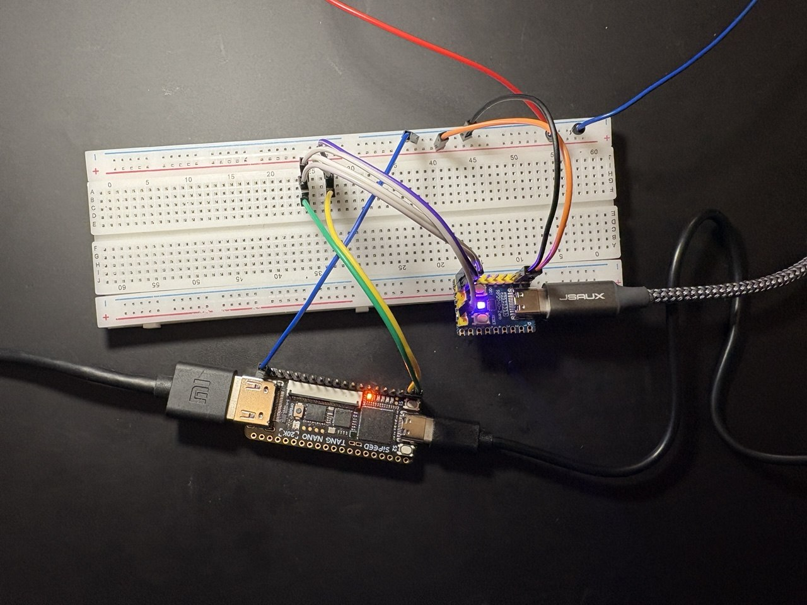

# ZX Spectrum on FPGA: the Krasnodar-48 on a Tang Nano 20K

[Русская версия](README.ru.md)

The **Krasnodar-48** is a Soviet-era ZX Spectrum 48K clone. This project
runs that board on a Sipeed **Tang Nano 20K** FPGA, not as a Spectrum
emulator but as the board itself. Its schematic (by Roman Boykov,
[romychs/Krasnodar-48](https://github.com/romychs/Krasnodar-48)) is
converted chip by chip into a Verilog netlist: the TTL and CMOS logic,
the DRAM timing made by RC delay lines, the 8255, the ROM, and a Z80 core
in the CPU socket.



*The Tang Nano 20K (front, HDMI on the left) and the RP2040-Zero USB keyboard adapter (right), wired on a breadboard.*

What it does on the Tang Nano 20K:

* **48K Spectrum**, the board's own logic at 13.5 MHz (see *Limitations*)
* **HDMI video, 1280x720 16:9**: every Spectrum pixel is 3x3 screen
  pixels, the picture is centred and the border colour fills the sides of
  the screen, loading stripes included. A 720x576 4:3 build is there too.
* **Sound over HDMI**: the beeper (and the tape output) through the
  monitor's speakers
* **Keyboard**: a 3.3 V PS/2 keyboard, or a USB keyboard through a small
  USB-to-PS/2 adapter: an RP2040-Zero running a modified
  [ps2pico](https://github.com/No0ne/ps2pico), firmware and wiring in
  [`ps2pico/`](ps2pico/)
* **Games from a microSD card**: F12 opens a menu; ENTER on a `.Z80`
  snapshot starts it, ENTER on a `.TAP` tape starts BASIC, types
  `LOAD ""` and loads the tape at card speed
* **Tests**: Icarus Verilog testbenches for the parts and for the whole
  board, down to checking every pixel of a 720p frame

## What you need

| | |
|---|---|
| board | Sipeed Tang Nano 20K |
| display | an HDMI monitor or TV. The output is 1280x720 at 48.3 Hz (or 720x576 at 48.3 Hz): frame-locked to the Spectrum, so not a standard rate. Most monitors accept it. |
| keyboard | a PS/2 keyboard **that works at 3.3 V**, or a USB keyboard + a Waveshare RP2040-Zero as an adapter ([`ps2pico/`](ps2pico/): ready-made firmware, wiring), on header pins **73** (CLK) and **74** (DATA) |
| card | a microSD card, FAT32 |
| ROM | the ZX Spectrum 48K ROM (Amstrad), not included: [download 48.rom](https://sourceforge.net/p/fuse-emulator/fuse/ci/master/tree/roms/48.rom?format=raw) ([Amstrad's permission](https://web.archive.org/web/20160119110852/http://www.worldofspectrum.org/permits/amstrad-roms.txt)); `scripts/get_rom.sh` fetches it for you |

## Software

| tool | for | notes |
|---|---|---|
| [Gowin EDA](https://www.gowinsemi.com/en/support/home/) 1.9.11 | building the bitstream | the free Education edition covers the GW2AR-18C |
| [openFPGALoader](https://github.com/trabucayre/openFPGALoader) | loading it into the board | |
| python3, z80asm, curl | ROM image, SD menu ROM | `apt install python3 z80asm curl` |
| [Icarus Verilog](https://github.com/steveicarus/iverilog) | simulation only | `apt install iverilog` |

## Quick start

```sh
git clone https://github.com/nechet/zx-spectrum-fpga-tang-nano-20k
cd zx-spectrum-fpga-tang-nano-20k

scripts/get_rom.sh               # the 48K ROM (see "The ROM" below)

export GOWIN=/path/to/gowin/IDE  # the folder that holds bin/gw_sh
scripts/build.sh                 # 720p build; "scripts/build.sh 576p" for 4:3

scripts/upload.sh                # into the FPGA, until power-off
scripts/upload.sh flash          # into the board's flash, for good
```

The bitstream lands in
`tang20k/gowin_sd720/impl/pnr/krasnodar_20k_sd720.fs`.

## The ROM

**ZX Spectrum 48K ROM (Amstrad), download:**
<https://sourceforge.net/p/fuse-emulator/fuse/ci/master/tree/roms/48.rom?format=raw>

* the same file on its page in the Fuse emulator's source tree: <https://sourceforge.net/p/fuse-emulator/fuse/ci/master/tree/roms/48.rom>
* a mirror on GitHub: <https://raw.githubusercontent.com/speccytools/fuse/master/roms/48.rom>
* checksum: sha1 `5ea7c2b824672e914525d1d5c419d71b84a426a2`, 16384 bytes

The ROM is copyright **Amstrad** and is **not** in this repository. Neither
are the bitstreams of the machine, since each one has the ROM built into
it. `scripts/get_rom.sh` downloads it from the link above, checks the
checksum and converts it for the build. To use your own copy, run
`scripts/get_rom.sh my48.rom`.

Amstrad allow the ROM to be used with emulators, as long as its copyright
messages are left unaltered and it is not sold:
[Amstrad's statement](https://web.archive.org/web/20160119110852/http://www.worldofspectrum.org/permits/amstrad-roms.txt) (Cliff Lawson, Amstrad, 1999; archived by World
of Spectrum). As they ask: *Amstrad have kindly given their permission for
the redistribution of their copyrighted material but retain that
copyright.*

## Using it

**Keyboard.** PC Shift is CAPS SHIFT; Ctrl or Alt is SYMBOL SHIFT;
the arrow keys are the Spectrum cursor keys (CAPS SHIFT + 5..8).
Backspace is DELETE.

**Buttons.** S1 resets the machine. S2 opens the games menu, the same as F12.

**Games menu.** F12 (or S2) stops whatever is running and lists the games
on the card. 7/6 or the arrows move the bar, ENTER loads the game, SPACE
goes back.

**The card.** FAT32, games in the root folder with short 8.3 names
(`MANIC.TAP`, `JETPAC.Z80`):

* `.Z80`: version 1 snapshots (48K), compressed or not
* `.TAP`: tape images; the tape is inserted, BASIC restarts and runs
  `LOAD ""`, and every block loads instantly from the card
* `.SNA` files are listed but cannot be loaded yet

Games are not part of this project. Use ones you are entitled to; many
authors allow theirs to be shared (see the availability notes on
[ZXDB / Spectrum Computing](https://spectrumcomputing.co.uk/)).

## Tests

```sh
scripts/test.sh          # quick: the line tripler and the HDMI sound (~10 min)
scripts/test.sh full     # the whole board: menu, .z80, .tap, a 720p frame (hours)
```

## Limitations

* The board runs at 13.5 MHz instead of 14 MHz, so the machine is 3.6 %
  slow and the frame rate is 48.3 Hz instead of 50. That is what lets one
  PLL make every clock and keep the picture locked to the board.
* `.Z80` version 2/3 snapshots and `.SNA` files are not loaded yet.
* No joystick can be connected yet. The Kempston port (31, 1Fh) reads
  as an interface with nothing plugged in, so snapshots saved with a
  Kempston joystick enabled play from the keyboard.

## What is where

The three folders keep the names they were developed under, so every path
in the build files and testbenches works as it is.

| folder | contents |
|---|---|
| [`tang20k/`](tang20k/) | the Tang Nano 20K port: HDMI (line tripler, sound), PS/2 keyboard, SD card loader and its menu ROM, Gowin builds, testbenches. Its [README](tang20k/README.md) is the detailed engineering log, and [LEARNING.md](tang20k/LEARNING.md) explains how it all works, for anyone who knows logic chips and is new to FPGAs |
| [`core/`](core/) | the shared core: top level, scan doubler, HDMI output, FPGA memories, and the generated board netlist (`gen/`) |
| [`Krasnodar-48-fpga/`](Krasnodar-48-fpga/) | the conversion of the schematic: KiCad versions, the Verilog netlist, synthesisable part models, the TV80 Z80 core and the converter tools |
| [`ps2pico/`](ps2pico/) | the USB keyboard adapter: modified ps2pico firmware for an RP2040-Zero, ready-made `ps2pico.uf2`, wiring |
| [`scripts/`](scripts/) | get the ROM, build, load, test |
| [`docs/`](docs/) | photos |

Builds in `tang20k/`: `gowin_sd720` (720p, the main one),
`gowin_sd` (576p), `gowin` (the bare 48K machine), `gowin_sdtest` (SD card
test), `gowin_hdmi720*` (720p test pattern and sound test, also in
`bitstreams/`).

## Licence and credits

Code in this repository: BSD 3-Clause, see [LICENSE](LICENSE).

* Krasnodar-48 schematic: Roman Boykov, BSD 3-Clause
  ([romychs/Krasnodar-48](https://github.com/romychs/Krasnodar-48))
* TV80 Z80 core: Guy Hutchison, after Daniel Wallner's T80; MIT ([hutch31/tv80](https://github.com/hutch31/tv80))
* HDMI packets and TMDS encoder: Sameer Puri,
  [hdl-util/hdmi](https://github.com/hdl-util/hdmi), MIT / Apache-2.0
  (the TMDS encoder via [apicula](https://github.com/YosysHQ/apicula))
* USB-to-PS/2 adapter firmware: No0ne, [ps2pico](https://github.com/No0ne/ps2pico), MIT
* ZX Spectrum ROM: Amstrad, not included
